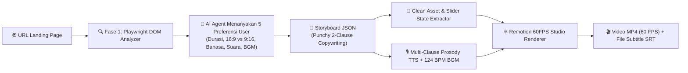

# 🎬 Auto Promo Video — AI Agent Skill (Remotion 60FPS Studio Edition)

[](LICENSE)
[](https://www.remotion.dev/)
[](https://playwright.dev/)
[](#)

**Auto Promo Video** adalah *AI Agent Skill* **All-in-One (Zero-Setup & 100% Gratis)** yang memungkinkan AI Coding Agent (seperti **Google Antigravity**, **Claude Code**, **Cursor**, **Windsurf**, atau **Cline**) mengubah URL *Landing Page* atau website apa pun menjadi **video promosi kualitas studio 60 FPS** layaknya hasil edit profesional di *After Effects* atau *Screen Studio*.

---

## ✨ Fitur Utama

1. **🎥 Hybrid Playwright + Remotion React (60 FPS Murni)**
   Tidak lagi mengandalkan *screen recording* mentah browser yang sering *lag*, *drop frame*, atau pecah (*blur*). Playwright mengekstrak aset visual *lossless* beserta koordinat DOM dan status klik *slider/carousel*, lalu **Remotion React** me-render setiap *frame* secara matematis di **60 FPS**.
2. **🪟 5-Layer Studio Compositor (`<AbsoluteFill>`)**
   - **Layer 1 — Studio Mesh Backdrop:** Latar belakang gelap elegan dengan *glowing radial orbs* yang bergerak dinamis.
   - **Layer 2 — Floating macOS Browser Frame:** Bingkai jendela browser macOS 3D dengan *traffic lights*, URL bar aktif, dan *sticky navbar* yang selalu terjaga rapi.
   - **Layer 3 — Spring Camera Rig & Ken Burns Drift:** Pergerakan kamera *zoom* & *pan* berbasis fisika pegas (`spring()`) yang tajam ke setiap fitur penting tanpa membuat teks buram.
   - **Layer 4 — Bezier Cursor & Live Slider Interaction:** Kursor bergerak melengkung secara alami (kurva Bezier), menampilkan *click ripple*, dan menggeser *carousel/slider* halaman secara nyata.
   - **Layer 5 — Kinetic Word-by-Word Karaoke Subtitles & 3D Intro/Outro Cards:** Subtitle berada di layer teratas dengan *highlight* kata demi kata (*emerald pill*) yang sinkron dengan suara narator.
3. **🎙️ Dynamic Prosody Voice Director ("Seni Ngomong Iklan") + Auto-Silence Trimmer**
   - Memecah naskah secara cerdas per klausa tanda baca (`!`, `?`, `—`) menjadi *Hook* (intonasi naik `+5Hz` s/d `+7Hz`, tempo sigap `+25%`), jeda nafas mikro `75ms`, dan *Punchline* tegas.
   - Dilengkapi **Auto-Silence Trimmer** untuk membuang jeda kosong (*dead air*) bawaan file MP3 TTS dan **Broadcast Vocal Exciter** agar suara terdengar jernih dan berenergi.
   - Mendukung **Bahasa Indonesia** & **Bahasa Inggris** (Suara Wanita, Suara Pria, atau Mode Tanpa Suara Narator).
4. **🎵 124 BPM Upbeat Commercial Groove BGM & Foley SFX Prosedural**
   Musik latar *commercial pop/tech pluck arpeggio* dengan ketukan *soft kick* & *shaker* 124 BPM (otomatis mengecil/*auto-ducking* saat narator berbicara), dipadukan dengan efek suara *whoosh*, *pop*, *mouse click*, dan *cinematic riser* yang di-generate langsung tanpa ketergantungan file eksternal.
5. **📱 Multi-Format (`16:9` & `9:16`) & Multi-Durasi (`30s`, `45s`, `60s`)**
   Mendukung format **Landscape (`1920x1080`)** untuk YouTube/Presentasi/Website dan **Portrait (`1080x1920`)** untuk Instagram Reels, TikTok, dan YouTube Shorts.

---

## 🏗️ Arsitektur Cara Kerja



---

## 🚀 Cara Instalasi

### 🌟 Cara 1: Claude Code & Codex (Plugin Marketplace)
Kamu bisa menginstalnya langsung dari chat/terminal AI layaknya plugin resmi:

**Claude Code** *(jalankan sebagai 2 prompt terpisah di chat)*:
```text
/plugin marketplace add hisyamabilkhoir/auto-promo-video
/plugin install auto-promo-video@auto-promo-video
```

**Codex**:
```bash
codex plugin marketplace add hisyamabilkhoir/auto-promo-video
codex plugin add auto-promo-video@auto-promo-video
```

---

### 📦 Cara 2: Via `npx` Installer (Praktis & Otomatis)
Jalankan salah satu perintah berikut di terminal project kamu:

```bash
# 1. Pasang langsung ke project saat ini (.agent/skills/auto-promo-video)
npx github:hisyamabilkhoir/auto-promo-video

# 2. Pasang sebagai GLOBAL PLUGIN di Google Antigravity (aktif di semua project!)
npx github:hisyamabilkhoir/auto-promo-video --global

# 3. Pasang khusus untuk Cursor
npx github:hisyamabilkhoir/auto-promo-video --cursor
```

---

### ⚡ Cara 3: Via `npx skills` (Standar Agent Skills CLI)
```bash
npx skills add hisyamabilkhoir/auto-promo-video
```

---

### 💻 Cara 4: Via `git clone` (Manual)
```bash
# Untuk Project Lokal
git clone https://github.com/hisyamabilkhoir/auto-promo-video.git .agent/skills/auto-promo-video

# Untuk Global Skill
git clone https://github.com/hisyamabilkhoir/auto-promo-video.git ~/.gemini/config/skills/auto-promo-video
```

> **💡 Catatan Zero-Setup:** Kamu **tidak perlu** menginstal library Python, Chromium, FFmpeg, atau menjalankan `npm install` secara manual. Saat skill ini pertama kali dipanggil untuk menganalisis atau me-render video, `promo_engine.py` akan mengunduh dan menyiapkan semua dependensi secara otomatis!

---

## 💬 Cara Penggunaan (Bersama AI Agent)

Cukup berikan perintah di chat AI Agent kamu seperti contoh berikut:

> *"Tolong buatkan video promosi untuk landing page `https://school.abynsstudio.com/` menggunakan skill auto-promo-video."*

AI Agent akan otomatis menjalankan **2 Fase Interaktif**:

### 1️⃣ Fase 1: Analisis Otomatis & Konfirmasi Preferensi
AI Agent akan memindai struktur halaman web (Heading, Section, Carousel/Slider, dan Tombol CTA), menampilkan ringkasan fitur menarik yang ditemukan, lalu menanyakan **5 pengaturan** kepada kamu:
1. **Durasi Target:** `30 Detik` / `45 Detik` / `60 Detik`
2. **Format Rasio Video:** `Landscape (16:9 - 1920x1080)` atau `Portrait / Reels (9:16 - 1080x1920)`
3. **Bahasa Narasi:** `Bahasa Indonesia` atau `Bahasa Inggris (English)`
4. **Pilihan Suara (Voiceover):** `Suara Wanita` / `Suara Pria` / `Tanpa Suara Orang (Hanya Musik & Visual)`
5. **Fitur Tambahan:** `Subtitle Karaoke Otomatis + Musik Latar 124 BPM`

### 2️⃣ Fase 2: Penyusunan Naskah Iklan & Rendering 60 FPS
Setelah kamu memilih, AI Agent akan menyusun `storyboard.json` dengan gaya **Punchy Commercial Micro-Copy** (maksimal 6–10 kata per scene dalam 2 klausa *Hook + Punchline*) dan menjalankan Remotion Studio Renderer hingga menghasilkan file `.mp4` dan `.srt`.

---

## 🛠️ Penggunaan Manual via CLI (Opsional)

Selain melalui chat AI Agent, kamu juga bisa menjalankan *engine*-nya langsung dari terminal:

```bash
# 1. (Opsional) Setup dependensi Python + Playwright Chromium + Remotion React
python .agent/skills/auto-promo-video/scripts/promo_engine.py --setup

# 2. Analisis struktur & elemen interaktif dari URL landing page
python .agent/skills/auto-promo-video/scripts/promo_engine.py --analyze "https://school.abynsstudio.com/" --out analysis.json

# 3. Render video promosi berdasarkan file storyboard.json
python .agent/skills/auto-promo-video/scripts/promo_engine.py --render examples/storyboard.example.json
```

---

## 📂 Struktur Direktori Skill

```text
auto-promo-video/
├── SKILL.md                          # Instruksi utama untuk AI Agent (Workflow 2 Fase & Aturan Copywriting)
├── README.md                         # Dokumentasi lengkap penggunaan & instalasi
├── scripts/
│   └── promo_engine.py               # Orkestrator Auto-Setup, Playwright Extractor, Prosody Audio & Remotion CLI
├── remotion_app/
│   ├── package.json                  # Konfigurasi paket Remotion 4.0 & React 18
│   ├── tsconfig.json                 # Konfigurasi TypeScript
│   ├── remotion.config.ts            # Konfigurasi kualitas frame PNG lossless
│   └── src/
│       ├── index.ts                  # Entry point Remotion
│       ├── Root.tsx                  # Kalkulasi metadata dinamis (16:9 / 9:16 @ 60 FPS)
│       └── PromoComposition.tsx      # Komponen 5-Layer Studio Compositor
└── examples/
    └── storyboard.example.json       # Contoh konfigurasi storyboard siap pakai
```

---

## 📋 Contoh Konfigurasi `storyboard.json`

```json
{
  "url": "https://school.abynsstudio.com/",
  "duration_preset": 45,
  "aspect_ratio": "16:9",
  "language": "id",
  "voice": "id_female",
  "subtitles": true,
  "bgm": true,
  "output": "promo_school_final.mp4",
  "scenes": [
    {
      "id": "scene_1",
      "selector": "h1.hero-title",
      "badge": "SMAN 1 NUSANTARA",
      "action": "overview",
      "zoom": 1.24,
      "voiceover": "Inilah SMAN 1 Nusantara! Rumah bagi generasi cerdas dan berdaya saing."
    },
    {
      "id": "scene_2",
      "selector": "button.btn-video-pill",
      "badge": "TUR INTERAKTIF",
      "action": "highlight_cta",
      "zoom": 1.48,
      "voiceover": "Penasaran serunya fasilitas kami? Putar video profilnya hanya satu klik!"
    },
    {
      "id": "scene_3",
      "selector": "div.programs-carousel-outer",
      "badge": "PROGRAM UNGGULAN",
      "action": "slide_programs",
      "zoom": 1.26,
      "voiceover": "Dari Kelas Riset hingga Robotika—geser dan pilih program impianmu!"
    },
    {
      "id": "scene_4",
      "selector": "a.btn-ppdb",
      "badge": "DAFTAR SEKARANG",
      "action": "highlight_cta",
      "zoom": 1.65,
      "voiceover": "PPDB resmi dibuka! Klik daftar sekarang dan raih masa depanmu!"
    }
  ]
}
```

### Pilihan Nilai Konfigurasi:
| Parameter | Nilai yang Didukung | Keterangan |
| :--- | :--- | :--- |
| `duration_preset` | `30`, `45`, `60` | Target durasi preset dalam detik |
| `aspect_ratio` | `"16:9"`, `"9:16"` | Landscape (`1920x1080`) atau Portrait Reels/TikTok (`1080x1920`) |
| `language` | `"id"`, `"en"` | Bahasa Indonesia atau Bahasa Inggris |
| `voice` | `"id_female"`, `"id_male"`, `"en_female"`, `"en_male"`, `"none"` | Suara narator neural atau tanpa suara narator (`"none"`) |
| `action` | `"overview"`, `"highlight_cta"`, `"zoom_in"`, `"slide_programs"`, `"slide_prestasi"` | Jenis aksi kamera & kursor interaktif pada elemen target |

---

## ☕ Traktir Kopi / Dukung Kreator

Skill ini dibuat dan dibagikan secara **100% Gratis & Open-Source** oleh **Abyns Studio** ([`@hisyamabilkhoir`](https://github.com/hisyamabilkhoir)).

Jika skill ini membantu mempercepat pekerjaan kamu, memukau klien, atau menghemat waktu *editing* video promosi, kamu bisa mendukung pengembangan fitur-fitur selanjutnya dengan mentraktir kopi melalui:

- 💳 **DANA:** **`085973729267`**

Terima kasih atas dukungannya, dan selamat berkarya! 🚀

